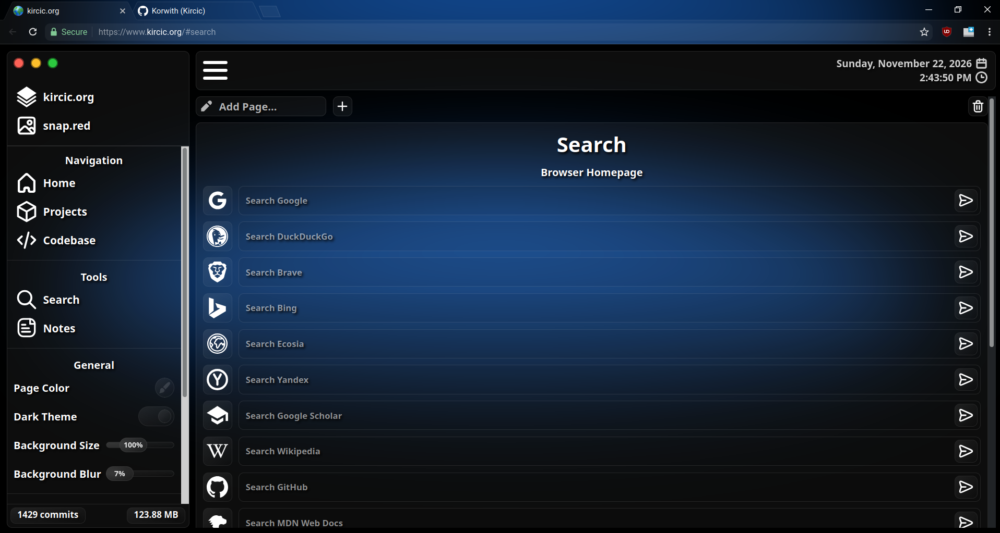
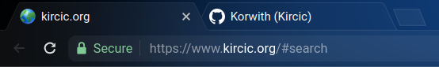

# LegacyChromeTabs

Classic (pre-2018) Chrome tabs for Firefox and every Gecko fork (Waterfox, LibreWolf, Floorp, Zen, ...).



## Install

```bash
./install.sh
```

Finds the default profile of every Gecko browser in your home folder (including Flatpak and Snap), then installs into all of them. Restart each browser afterwards.

| Flag | |
|---|---|
| `--list` | show the browsers found and exit |
| `--browser NAME` | only this browser (repeatable, e.g. `--browser firefox --browser zen`) |
| `--profile DIR` / `--install-dir DIR` | one specific profile / install folder |
| `--theme glass\|classic` | palette (default `glass`) |
| `--recommended-prefs` | also set the prefs the theme was tuned with (compact density, no vertical tabs, full URLs, ...) |
| `--no-loader` | no `sudo`; skips the eased tab drop, the Colors panel and auto-pinning new extensions (the extensions button then stays visible) |
| `--uninstall` | remove everything (files go to `<profile>/chrome/backup-<date>/`) |
| `-y` | don't ask |

The script loader is skipped for Flatpak/Snap builds and for browsers that already use autoconfig (e.g. LibreWolf); the theme itself still installs.

## Themes



- **`glass`**: black window with a blue glow, translucent tabs and toolbars.
- **`classic`**: Chrome's blue frame and `#f2f2f2` toolbar; follows Settings → Website appearance for light/dark.

Switch live with the `userChrome.ct.theme` pref in `about:config`.

## Customization

**⋮ menu → Colors & opacity** edits the active palette live in every window:

- **Glass**: tint, glow, window background, menus, accent; opacity of toolbar/active tab, background tabs, edges and glow.
- **Classic**: frame top, frame bottom, toolbar.

Values are stored as `userChrome.ct.glass.*` / `userChrome.ct.classic.*` prefs; **Reset** clears them.
